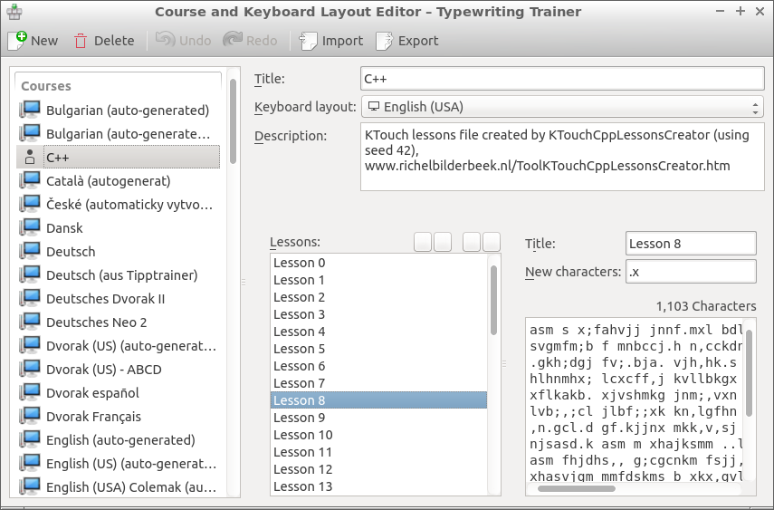

# KTouchCppLessonsCreator

Create random KTouch lectures for C++ programmers.

KTouchCppLessonsCreator is one of [Richèl Bilderbeek's tools](https://richelbilderbeek.github.io/tools/).

## Links

- [Source code](https://github.com/richelbilderbeek/KTouchCppLessonsCreator)
- [Richèl Bilderbeek's tools](https://richelbilderbeek.github.io/tools/)
